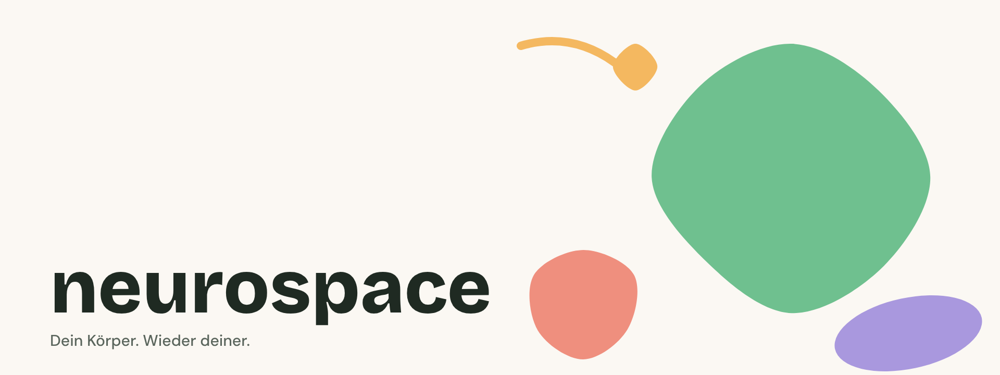
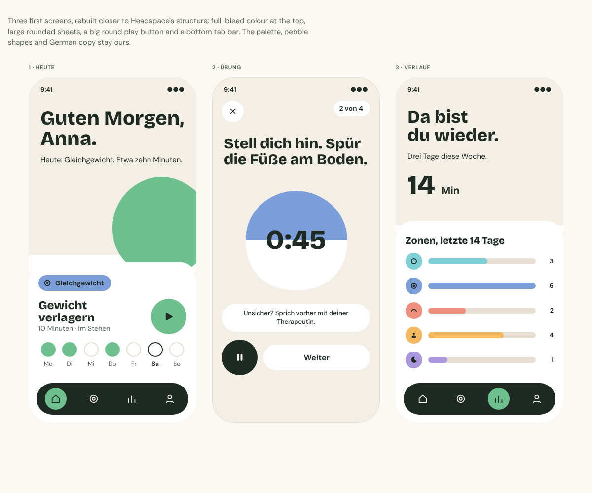
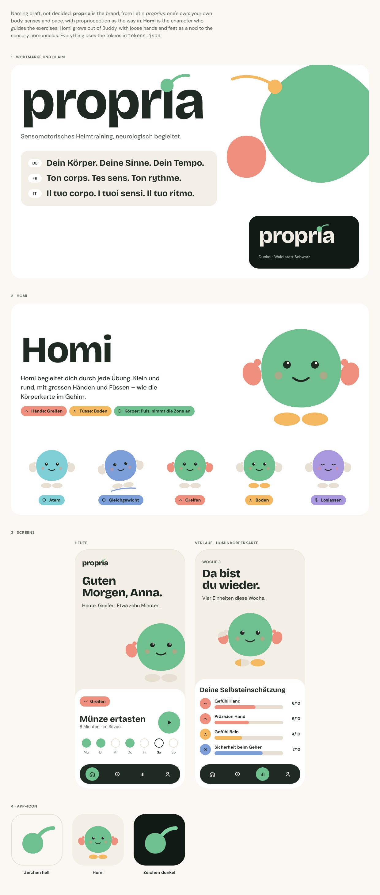

# neurospace

> Dein Körper. Wieder deiner. – Ton corps, à nouveau à toi. – Il tuo corpo, di nuovo tuo.
>
> Sensomotorisches Heimtraining, neurologisch begleitet.

neurospace helps people feel and move their body again, at home, with exercises guided by neurology.
Many people who come to it are recovering from something that changed how their body feels to them,
so the brand should be warm, plain and kind, and never make anyone feel tested.

This book is a working draft. Anything still undecided is listed at the end.

## Voice

We sound like a physiotherapist who has time for you. Friendly, direct, a little dry, never loud.

Write in short sentences and say what the body can notice: a foot on the floor, a breath that reaches
the back, a hand finding its way back. Avoid words about achievement or performance. Nobody is
being graded.

- German leads. French and Italian follow the same rhythm, not word-for-word.
- Use the informal address: **du** in German, **tu** in French and Italian.
- Invite rather than instruct: "Probier's aus", "Lass den Arm kommen". Plain commands are for safety only.
- Be honest about difficulty: "Das kann sich fremd anfühlen. Das ist normal."
- Celebrate a return, not a result: "Da bist du wieder."

We support and accompany. We never promise a cure, a diagnosis or a restored function, so avoid
"heilen", "garantiert", "Wunder" and before-and-after framing.

The name is always lowercase: **neurospace**.

## Colour

The palette is soft on purpose. Most of a screen is warm paper and ink, and colour appears where it
tells someone something.

**Pulse** (`#6fc08f`) is a soft green and the one thing on a screen a person should press: the main
button, the active state, a completed ring. It sits with dark ink text, never white. Green for text
on light is a darker shade, `pulse-ink`, so links and completion words stay readable.

Five colours mark the body zones. Each exercise trains one part of the body, and its colour, its
label and its icon say which:

| Zone | Token | Body | Label |
| --- | --- | --- | --- |
| Breath | `breath` | breathing, ribcage, exhale | Atem |
| Balance | `balance` | standing, weight shift, stillness | Gleichgewicht |
| Reach | `reach` | arms, hands, stretching, grip | Greifen |
| Ground | `ground` | feet, floor contact, legs | Boden |
| Rest | `rest` | wind-down, sleep, release | Loslassen |

Zone colours are for fills and illustration. Text on any of them is dark ink. Some people see colour
differently, so a zone is never identified by colour alone; its label and icon always appear with it.

`caution` is a warm brown for "slow down, or check in with your therapist". It is deliberately not red.

Dark mode is a deep forest rather than black, with the same zone colours.

## Type

Two families, both free Google fonts (SIL Open Font License), self-hosted in `app/fonts/`. **Bricolage Grotesque** is for headings and
the wordmark: a little uneven at heavy weights, friendly rather than polished. **DM Sans** is for
everything else, round and easy to read at small sizes.

Headings sit large and tight. Body text is 16–18px with generous leading, because people read this
while lying down or while recovering their focus.

## Shape and space

Corners are soft. Buttons and chips are full pills. Cards and sheets have 32px corners. Layers are
separated by a change of surface, not shadows. Space is generous, in steps of 8, 16, 24 and 48px,
because a tight screen is a tense screen.

**The mark (not yet drawn).** A dot with one tail, as a neuron sends a signal. The dot is slightly
irregular, as a hand-drawn circle is.

**Drawing.** Shapes are imperfect circles: smooth and slightly uneven, the way a hand-cut shape is.
They sit loosely in the composition with room between them, and nothing is set on a grid. Avoid hard
geometry, sharp points and black fields. Colour carries the energy, not contrast. A dot with a short
tail is the signal and the mark: one small curve leaving a round dot. Motion is slow and springy,
250–400ms, and always reduced when the person asks for less.

## Pictures and icons

Photography shows real bodies at home and in motion: feet on a floor, hands reaching, a back in
afternoon light. No gym posing, no mirror selfies, no stock smiles.

Illustration is simple and flat, using the zone colours. Faces are not needed; a bare foot or an open
hand says enough.

Icons have one 2px stroke on a 24px grid, with rounded ends. Each zone icon must make sense in plain
black and white.

## Using the system

- Build from the tokens. Don't type hex values into screens.
- Each exercise has one zone. Show its colour, label and icon together.
- One pulse button per screen, at most.
- Put dark ink on any colour fill. Use ink or muted ink on paper.
- Every state has a shape, a label or an icon, as well as a colour.
- Design dark mode alongside light, not afterwards.
- Write the German first, then translate once it reads naturally.

## First screens

Three first mockups (Today, one exercise, Progress), in light mode: [`mockups/first-screens.html`](mockups/first-screens.html) and the preview below.

## Naming draft: propria and Homi

A proposal, not a decision. **neurospace** stays the working name until the name is cleared.

**propria** would be the brand, from Latin *proprius*, one's own: your own body, senses and pace.
Proprioception is the way in, not the whole meaning («Eigenwahrnehmung» in German also means
self-awareness), so the name leaves room for more than touch and position sense. It is written in
lowercase, like neurospace. The dot of the i is the mark: the dot with one tail described above.

**Homi** would be the character who guides the exercises. Homi grows out of Buddy
(`components/Buddy.tsx`): the same pebble, face and green, plus loose hands and feet as a nod to the
sensory homunculus, the body map in the brain. Hands light up for Greifen, feet for Boden, and the
whole body takes the zone colour for Atem, Gleichgewicht and Loslassen. On Verlauf, Homi becomes the
body map: a hand or foot fills up with the person's own weekly ratings. Homi stays soft and round,
never anatomical. Drawing: [`homi.svg`](homi.svg).

Claim, describing the practice rather than promising a result:

> Dein Körper. Deine Sinne. Dein Tempo. – Ton corps. Tes sens. Ton rythme. – Il tuo corpo. I tuoi sensi. Il tuo ritmo.

The current claim, «Dein Körper. Wieder deiner.», reads as a promise of recovery, which the voice
section rules out.

Mockup: [`mockups/propria-homi.html`](mockups/propria-homi.html) and the preview below.

Before deciding: a trademark search (Swissreg and EUIPO, classes 9, 10, 41 and 44) and the domains.
A US biotech called Propria (engineered heart tissue) exists; check it with a trademark lawyer.

## Still open

- The logo. The dot and tail is sketched in the naming draft, but not properly drawn yet.
- A colour-vision check of the zones with a simulator.
- Icons, illustration and photography direction.
- Motion tokens. Durations are described here but not yet in the tokens.
- Components: buttons, exercise cards, zone chips, progress, session timer.
- A French and Italian copy guide.
